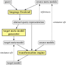

# Implementation

## Structure

The following diagram shows the main components of NeoJoin (yellow boxes) and their inputs and outputs (grey boxes).

The **language frontend** parses the given query and together with the referenced source meta-models generates and abstract representation of the query (AQR). The **target meta-model generator** uses the AQR to generate an Ecore meta-model for the view. The **transformation engine** transforms source instance-models into an instance of the view using the AQR and the view's meta-model.

#### Frontend/Language

* [Xtext grammar for NeoJoin](/frontend/language/src/main/xtext/tools/vitruv/neojoin/NeoJoin.xtext) ([Xtext grammar reference](https://eclipse.dev/Xtext/documentation/301_grammarlanguage.html))
* `aqr` - AQR generation. Xtext provides an abstract representation of the input query file. The `AQRBuilder` performs various normalizations to generate the AQR from Xtext's query representation. These normalizations include:
    * inferring feature types based on the given expressions
    * transformation subqueries into top-level queries
    * generating queries for classes which are referenced but not explicitly generated from a query
    * populating query target classes with features when no body was provided (e.g. `from Food create`)
    * collecting declared query parameters and their types for resolution during transformation
    * wiring the super classes of target classes (declared via `extends`) and linking implicit target classes to the target classes of their source super classes (if they have equivalent features)
    * applying inheritance: a feature that overrides an inherited feature takes its type and modifiers, and all inherited features must be overridden
    * not generating root references for abstract classes
* `collector` - collecting input models (meta or instance) from a given search path
* `generation` - target meta-model generation from AQR
* `jvmmodel` - Xtend expressions (= Xbase) work on java classes.
    * To allow for expressions to reference classes and attributes of Ecore models, the `SourceModelInferrer` generates java representations of the input Ecore models.
    * In order to use the type checking that is provided by Xtext, we need to tell Xtext what local variables are in scope of each expression. This is done in the `QueryModelInferrer` which creates a method for each expression and defines local variables as parameters.
* `scoping` - provides scoping information, e.g. meta-models available for import, classes that can be referenced in queries
* `validation` - custom validation rules for queries that cannot be expressed as part of the grammar, e.g. duplicated names

## Loading Models

All models are loaded into resource sets created by `EMFUtils.createResourceSet(registry)`. Such a resource set
* reads and writes `.ecore` and `.xmi` files (the resource factories are registered on the resource set, not globally),
* finds meta-models by namespace URI among the packages of the given registry, then in the global package registry `EPackage.Registry.INSTANCE` (Ecore itself and the generated EMF packages on the class path; a package registers itself when it is first used), so that models are loaded with the meta-models that the queries use,
* never loads anything from the network: EMF would otherwise download the namespace URI of an unknown meta-model (`http://example.org/x`) as its location.

The collectors find the files of a model path (`ModelPath.findFiles`) and load them (`AbstractModelCollector.loadResources`) in the order of the path and, within a directory or archive, sorted by path; a file that several entries contain (a directory and a file in it) is loaded once. Empty entries (`;a`, `a;;b`, an empty path) are ignored; otherwise they would stand for the working directory. Problems do not stop the loading; each one is a `CollectorIssue` with a severity. The CLI prints the issues as `[WARNING] ...` and `[ERROR] ...` and does not transform if the instance models have an error; the language server shows the issues of the meta-models as messages when it starts.

| Problem | Meta-models (`PackageModelCollector`) | Instance models (`InstanceModelCollector`) |
|---|---|---|
| Path entry is invalid, does not exist or is a file with another extension (the warning names the meta-model or instance model path) | Warning, entry skipped | Warning, entry skipped |
| Directory cannot be read, archive cannot be opened | Warning, the directory or archive is skipped | Warning, the directory or archive is skipped |
| File cannot be loaded, or contains no package or no model elements | Warning, file skipped (a query importing the meta-model reports it as unknown) | Warning, file skipped (a transformation that selects instances of its meta-model reports the instance model as missing) |
| Package with the namespace URI of a global package (for example a copy of Ecore) | Warning, the global package is used instead (queries can import it, and the instance models are loaded with it) | – |
| Several packages with one namespace URI | Warning, none of them is used, and meta-models that reference them are left out too | – |
| Meta-model references a class, enumeration or data type outside the path or a data type without instance class, or has a feature without type | Warning, meta-model left out, also every meta-model that references it | – |
| Instance model of a meta-model that is not in the registry (the namespace of the root element, also if the file cannot be loaded) | – | Warning, file skipped (a query cannot import that meta-model) |
| Instance model with roots of several meta-models | – | Used as instance model of each of them |
| Root element of a class in a sub package | – | Used as instance model of the root package, by which the transformation looks it up |
| Several instance models of one meta-model | – | Error, also if some of the files cannot be loaded (counted by the namespace of their root element, which StAX can often read in a broken file) |

## Package Registries

EMF finds meta-models (`EPackage`s) by their namespace URI in package registries: a map from namespace URIs to packages, optionally with a delegate registry that is asked for URIs it does not contain. NeoJoin uses these registries:

| Registry | Contents | Used for |
|---|---|---|
| Registry returned by `PackageModelCollector.collect()` | The meta-models on the meta-model path (including sub packages; the global package instead of a copy of it), without delegate | Everything that asks for the source meta-models of a query: the meta-models available for import (`NeoJoinScopeProvider`), the Java types that expressions use (`SourceModelInferrer`, which infers all packages of the registry plus Ecore), the reference meta-model of `conforms to` (`NeoJoinValidator`). The CLI passes it to `NeoJoinStandaloneSetup`, the language server through `NeoJoinIdeSetup.Registry`. |
| Package registry of the resource set in `PackageModelCollector` | The same meta-models except copies of global packages, delegates to the global registry | Loading the meta-models: references to other meta-models by namespace URI (`http://example.org/supplier#//Food`) resolve to the meta-models on the path, references to Ecore types (`http://www.eclipse.org/emf/2002/Ecore#//EString`) through the global registry. |
| Package registry of the resource sets for instance models (`InstanceModelCollector`) and parameter models (`ParameterResolver` in the CLI) | A copy of the registry returned by `collect()`, delegates to the global registry | Finding the meta-model of an `.xmi` file by namespace URI, also references to Ecore elements (`<type xsi:type="ecore:EDataType" href="http://www.eclipse.org/emf/2002/Ecore#//EString"/>`). |
| Global registry `EPackage.Registry.INSTANCE` | Ecore and the packages registered in the JVM | Only through the delegation above; NeoJoin does not add packages to it. |
| Package registries of the resource sets for queries (`Parser`, the language server) | Default (delegate to the global registry) | Nothing NeoJoin relies on: imports in a query resolve through the scope provider. |

The registry returned by `collect()` has no delegate on purpose: `EMFUtils.collectAvailablePackages` follows delegates, so with one, every package of the JVM would be offered for import and inferred.

Every feature of a collected meta-model needs a type, every class, enumeration and data type that it uses as super class or feature type must be in the returned registry or in Ecore, and every data type needs an instance class, because `SourceModelInferrer` maps each of them to a Java type. Meta-models that break this rule are left out (see the table above), for example a meta-model that uses a data type of XMLType, which is only in the global registry. A copy of a global package is replaced only if the global package was used before: generated packages register themselves when they are first used. Ecore is always registered, XMLType as soon as a `.ecore` file is loaded. The packages of Xtext and Xbase (for example `JavaVMTypes`) are registered when the language is set up, which the CLI and the language server do after collecting the meta-models. A copy of such a package on the path is used like any other meta-model, for the queries and for loading the instance models.
